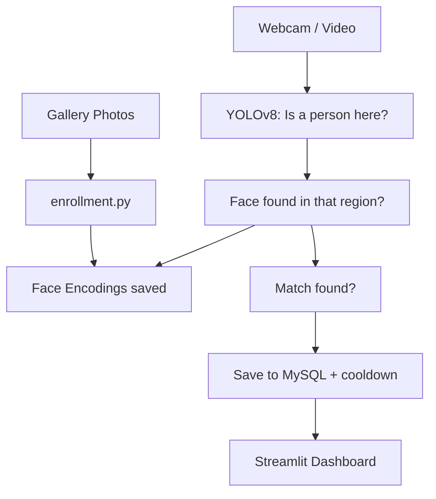

# 🎯 IdentiTrack

### A webcam that doesn't just see people — it knows who they are.

[](https://www.python.org/)
[](https://opencv.org/)
[](https://ultralytics.com/)
[](https://streamlit.io/)
[](https://www.mysql.com/)

I built IdentiTrack to really understand how a computer vision system works — not just
detecting people in a video, but turning that into something actually useful: knowing who
showed up, when, and for how long.

You show it a few photos of someone once. After that, it recognizes them — on a live
webcam or in an uploaded video — using two steps: first YOLOv8 checks if a person is there
at all (even if their face isn't visible), then face recognition figures out who it is.
Every match gets saved to MySQL, and a Streamlit dashboard turns that data into something
you can actually read — peak hours, how often someone showed up, trends over time.

Building this meant thinking like two people at once: an engineer trying to get the
detection right, and an analyst trying to make the data actually mean something.

---

## 🔑 Highlights

- **Two steps, not one** — YOLOv8 spots a person first, face recognition confirms who it is, so it still catches someone even when their face isn't visible
- **Live or recorded** — works on a live webcam feed, or you can upload a video and it'll process the whole thing
- **Goes beyond detection** — raw video turns into structured database records, and then into an actual dashboard you can explore
- **Built with real-world habits in mind** — duplicate detections get filtered out, and the database password never touches the code

---

## 🚀 Features

- 👤 **Face enrollment** — add someone by just dropping a few of their photos in a folder
- 🎯 **Two-stage detection** — YOLOv8 checks if a person is there at all, then face recognition figures out who it is
- 📹 **Live webcam tracking** — runs in real time, draws boxes and names right on screen
- 🎬 **Works on video files too** — not just live webcam, you can upload a video and it'll process the whole thing
- 🗄️ **Logs to MySQL** — with a cooldown so it's not spamming the same detection every frame
- 📊 **Dashboard with real analytics** — peak hours, who showed up when, daily trends, and you can export it all as CSV
- 🔍 **Filter by person or date** — easy to dig into specific records
- 🔒 **Keeps credentials safe** — DB password lives in a .env file, never in the code

---

## 🛠️ Tech Stack

| Layer | Technology |
|---|---|
| Language | Python 3.10 |
| Person Detection | YOLOv8 (Ultralytics) |
| Face Recognition | `face_recognition` (dlib-based, 128-d facial embeddings) |
| Video Processing | OpenCV, imageio (H.264 encoding) |
| Database | MySQL |
| Dashboard | Streamlit |
| Data Analysis | Pandas |
| Configuration | python-dotenv |

---

## 🧠 How It Works



Basically, here's what happens step by step:

1. You drop a few photos of someone into `gallery/<PersonName>/`, and `enrollment.py`
   converts each face into a set of 128 numbers (a kind of fingerprint) saved in `encodings.pkl`.

2. When the webcam or a video runs, every single frame goes through YOLOv8 first — it just
   checks "is there a person here?", whether or not their face is visible.

3. If a person is found, the system looks for a face inside that region. If there's one,
   it compares it against all the saved fingerprints to figure out who it is.

4. Whenever it finds a match, it saves that to MySQL — but with a cooldown, so it's not
   logging the same person every single frame while they're just standing there.

5. The dashboard then reads all this data back and turns it into something useful —
   detection counts, busiest hours, trends over time, and so on.

## 📁 Project Structure

```
IdentiTrack/
├── gallery/                  # photos of people to enroll, one folder per person
├── config.py                 # all the settings in one place (DB creds come from .env)
├── enrollment.py             # reads gallery photos, saves face encodings
├── tracker.py                # live webcam tracking - the main detection loop
├── video_processor.py        # same detection logic, but for uploaded videos
├── database.py               # all the MySQL stuff - save, fetch, clear
├── dashboard.py              # the Streamlit app - charts, filters, everything
├── requirements.txt          # dependencies (see Getting Started)
└── README.md
```

## ⚙️ Getting Started

Set up a virtual environment and install the dependencies:

```bash
cd IdentiTrack
python -m venv venv
venv\Scripts\activate        # Windows
pip install -r requirements.txt
pip install face_recognition --no-deps
```

`face_recognition` is installed with `--no-deps` on purpose. Without it, pip tries to build
dlib from source, which fails on Windows unless Visual Studio is installed. The `dlib-bin`
package in `requirements.txt` already provides dlib.

You need MySQL installed and running. Put your password in a `.env` file in the project folder:

```
DB_PASSWORD=your_mysql_password
```

Create the database and table:

```sql
CREATE DATABASE identitrack_db;
USE identitrack_db;

CREATE TABLE detections (
    id INT AUTO_INCREMENT PRIMARY KEY,
    person_name VARCHAR(100),
    detected_at DATETIME DEFAULT CURRENT_TIMESTAMP
);
```

The photos are not part of the repo. Create a `gallery/` folder with one subfolder per
person (for example `gallery/Rahul/` with 2 or 3 clear photos), then:

```bash
python enrollment.py         # learns the faces in gallery/
python tracker.py            # live webcam tracking (press q to quit)
streamlit run dashboard.py   # the analytics dashboard
```

The YOLOv8 model file is downloaded automatically the first time you run it, so you need an
internet connection for that run.

## 📊 Future Scope

There's a lot of advanced stuff I intentionally didn't build into this version — things like
handling cases where two people cross paths and the system has to figure out who's who, which
is honestly a whole research area on its own. For this project, I focused on getting a complete,
understandable pipeline working end-to-end rather than a half-built complex one. A few things
I'd like to add going forward:

- Support for multiple camera feeds running at once
- Real-time alerts when a specific person is detected
- Docker-based deployment for a more production-ready setup
- Better handling of crowded scenes using segmentation-based detection
- Automated daily/weekly summary reports

## 👨‍💻 Author

**Abhay Marwade**

Aspiring Data Analyst | Data Science & AI Enthusiast

🔗 GitHub: [ABHAYMARWADE2004](https://github.com/ABHAYMARWADE2004)
